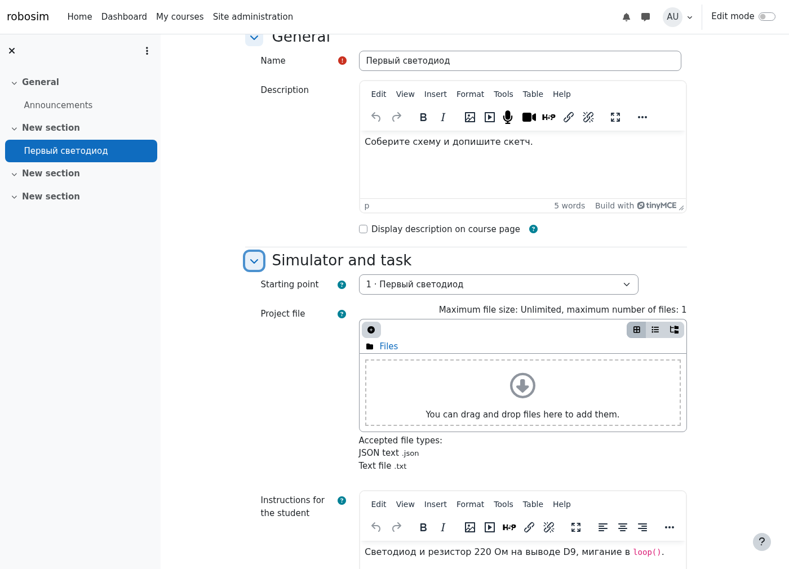
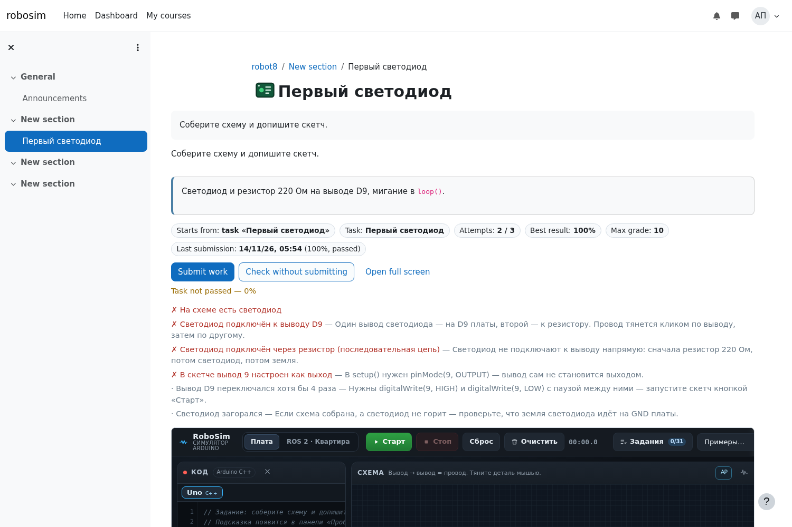
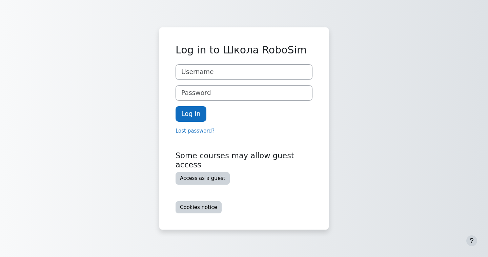
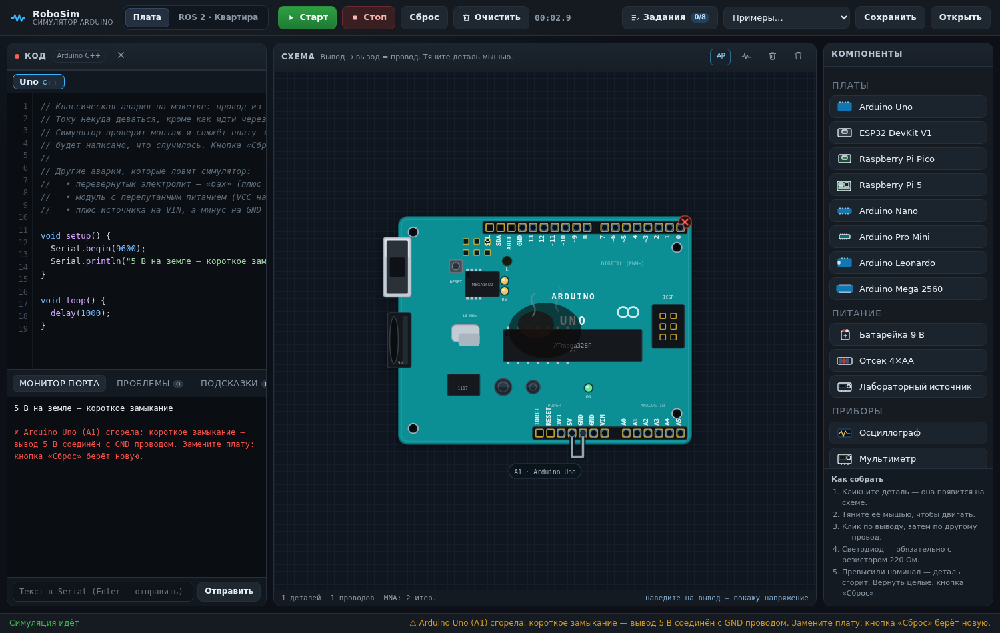

# RoboSim для Moodle — ветка `moodle`

В этой ветке лежит **плагин-элемент курса `mod_robosim`** для Moodle: симулятор
Arduino (RoboSim) упакован внутрь плагина, поэтому школа работает без интернета,
без внешних CDN и без отдельного сервера. Учитель добавляет элемент курса,
выбирает пример или учебное задание, ученик собирает схему в браузере и сдаёт
работу — оценка попадает в журнал.

Сайт-симулятор живёт в ветке `main` (`https://pavelb-coder.github.io/sim-ard/`),
а эта ветка — только плагин и инструменты его сборки.

```
moodle/
├── mod/robosim/            ← то, что копируется в Moodle
│   ├── version.php
│   ├── lib.php             ← стандартные функции mod: оценки, файлы, бэкап
│   ├── mod_form.php        ← настройки элемента курса
│   ├── view.php            ← страница ученика: iframe + «Сдать работу»
│   ├── submit.php          ← приём работы (AJAX) и выставление оценки
│   ├── report.php          ← отчёт и ручное оценивание
│   ├── download.php        ← скачать работу ученика (.json)
│   ├── grade.php, index.php, settings.php, styles.css
│   ├── db/                 ← права, таблицы, обновление
│   ├── backup/moodle2/     ← резервное копирование и восстановление
│   ├── classes/            ← события, политика конфиденциальности, проекты
│   ├── lang/{en,ru}/       ← строки интерфейса
│   ├── templates/          ← шаблон страницы (Mustache)
│   ├── js/player.js        ← связка страницы с симулятором
│   ├── simulator/          ← сам RoboSim (index.html, styles.css, js/**)
│   ├── examples.json       ← 46 готовых примеров (схема + скетч)
│   └── tasks.json          ← 31 учебное задание: цели, критерии, пример-решение
└── tools/
    ├── extract-examples.mjs   ← выгружает примеры и задания из сайта
    ├── sync-simulator.sh      ← копирует файлы симулятора в плагин
    └── release.sh             ← коммит и пуш этой ветки
```

## Установка

1. Скопируйте каталог `mod/robosim` в Moodle:

   ```sh
   cp -R moodle/mod/robosim /path/to/moodle/mod/robosim
   ```

   (или `git archive moodle:mod/robosim | tar -x -C /path/to/moodle/mod`)

2. Зайдите в Moodle администратором → **Администрирование → Уведомления**.
   Moodle увидит новый плагин и предложит установить.

3. Права появятся у ролей автоматически:
   `mod/robosim:addinstance`, `:view`, `:submit`, `:grade`, `:viewreports`.

Требования: **Moodle 4.0+** (проверялось на 4.x и 5.x), PHP 7.4+, никаких
расширений сверх обычных. База — MySQL/MariaDB/PostgreSQL, всё через XMLDB.

## Запуск: Ubuntu, Windows и без Moodle

### Только посмотреть симулятор (Moodle не нужен)

Внутри плагина лежит полноценная копия симулятора, её можно открыть локально.
Нужен любой статический сервер — открывать `index.html` как файл нельзя,
браузер не загрузит ES-модули из `js/`.

```sh
# Ubuntu / Debian / macOS / WSL
python3 -m http.server 8080 --directory mod/robosim/simulator
# → http://localhost:8080/
```

```bat
:: Windows (PowerShell или cmd)
cd mod\robosim\simulator
py -3 -m http.server 8080
:: → http://localhost:8080/  (остановить: Ctrl+C)
```

### Moodle + плагин на Ubuntu (одна команда)

Нужны Ubuntu 22.04/24.04 или Debian и права root. Скрипт поставит Apache,
MariaDB, PHP с расширениями, скачает Moodle 4.5 LTS, положит плагин в
`mod/robosim`, создаст базу и `moodledata` и прогонит установку из консоли.

```sh
sudo ./tools/install-moodle-ubuntu.sh
# → Сайт: http://localhost   Администратор: admin / Robosim123!
```

Что-то поменять — переменными окружения:

```sh
sudo MOODLE_URL=http://moodle.local ADMIN_PASS='СложныйПароль1!' ./tools/install-moodle-ubuntu.sh
```

Ручной вариант, если Moodle уже стоит:

```sh
sudo cp -R mod/robosim /var/www/moodle/mod/robosim
sudo chown -R www-data:www-data /var/www/moodle/mod/robosim
sudo -u www-data php /var/www/moodle/admin/cli/upgrade.php --non-interactive
```

Дальше — вход администратором и «Уведомления»: Moodle сам предложит установить
новый плагин, если скопировать файлы на уже работающий сайт.

### Moodle + плагин на Windows (XAMPP)

1. Поставьте **XAMPP** с PHP 8.1–8.3 (xampp-windows, версия 8.2 подходит):
   <https://www.apachefriends.org/download.html>. Запустите **Apache** и **MySQL**
   из панели XAMPP.
2. Скачайте Moodle 4.5 LTS: <https://download.moodle.org/download.php/direct/stable405/moodle-latest-405.tgz>
   (это `.tgz`; Windows откроет его 7-Zip, или возьмите `.zip` из
   <https://download.moodle.org/windows/>).
3. Распакуйте в `C:\xampp\htdocs\moodle`.
4. Скопируйте плагин: каталог `mod\robosim` из этой ветки →
   `C:\xampp\htdocs\moodle\mod\robosim`
   (или распакуйте `mod_robosim-1.0.3.zip` туда же).
5. Создайте папку для данных `C:\xampp\moodledata` (вне `htdocs`).
6. Откройте <http://localhost/moodle/> и пройдите установку: тип базы
   **MariaDB**, хост `localhost`, база `moodle`, пользователь `root`, пароль пустой
   (по умолчанию в XAMPP), каталог данных `C:\xampp\moodledata`.
7. Плагин попадёт в список автоматически. Если ставите плагин на уже работающий
   сайт — скопируйте файлы и откройте «Администрирование → Уведомления».

Проверить, что всё на месте, можно так (из каталога Moodle):

```bat
php admin\cli\upgrade.php --non-interactive
php admin\cli\purge_caches.php
```

### Совместимость версий

| Moodle | Плагин |
|---|---|
| 4.0 – 4.5 LTS | работает, проверено статически и в браузере |
| 5.0 | должен работать (та же структура каталогов) |
| 5.1 и новее | установщик откажет: в `version.php` объявлено `supported = [400, 500]`, а с 5.1 корень сайта переехал в `public/`, и путь к плагину другой |

Для Moodle 5.1+ плагин нужно отдельно переносить в `public/mod/robosim` и
проверять заново — это отдельная задача, а не «просто скопировать».

## Как это выглядит в курсе

1. Учитель в курсе нажимает «Добавить элемент или ресурс» → **Симулятор RoboSim**.
2. В настройках выбирает:
   * **С чего начинает ученик** — готовый пример (46 штук), учебное задание
     (31 штука, с автопроверкой) или свой проект (ссылка `#p=…` / файл `.json`);
   * **Инструкцию ученику** — показывается над симулятором;
   * **максимальную оценку**, **автопроверку** и **число попыток**.
3. Ученик открывает элемент курса: симулятор уже загружен с нужной схемой.
   Собирает схему, пишет скетч, жмёт «Старт».
4. Кнопка **«Проверить без сдачи»** прогоняет проверки задания и показывает
   список «✓/✗» с подсказками, ничего не записывая.
5. Кнопка **«Сдать работу»** отправляет схему, скетч и результат проверки на
   сервер. Дальше:
   * включена автопроверка и задание пройдено → оценка сразу в журнале;
   * иначе работа попадает в отчёт, и оценку выставляет учитель.
6. Учитель в **«Сданные работы»** видит всех учеников, число попыток, лучший
   результат, может открыть работу в симуляторе, скачать `.json`, поставить
   оценку или удалить попытку.



## Что внутри плагина

| Возможность | Где |
|---|---|
| 46 готовых примеров и 31 задание (у каждого — цели, критерии и пример-решение) | `examples.json`, `tasks.json` |
| Кнопка «Решение» в карточке задания: открывает готовый пример с автозапуском | `tasks.json` → `solutionExample`, `player.js` |
| USB-кабель между двумя платами и порт `/dev/ttyACM0` для Raspberry Pi 5 | `simulator/js/runtime.js`, `simulator/js/parts.js` |
| Настоящая плата по USB: Web Serial из браузера ученика (Chrome, Edge, Opera) | `simulator/js/webserial.js` |
| Симулятор со схемой, решателем цепей и компиляторами C++/MicroPython | `simulator/` |
| Аварии: короткое замыкание и переполюсовка сжигают деталь или плату | `simulator/js/circuit.js` → `_burn()` |
| Автопроверка задания в браузере ученика | `js/player.js` → `__sim.checkTask()` |
| Приём работы, попытки, оценка | `submit.php`, `lib.php` |
| Отчёт, ручное оценивание, скачивание | `report.php`, `download.php` |
| Резервное копирование курса | `backup/moodle2/` |
| GDPR: экспорт и удаление работ | `classes/privacy/provider.php` |
| Журнал событий | `classes/event/` |
| Русский и английский интерфейс | `lang/ru`, `lang/en` |

## Курс: 31 задание

Задания идут тремя уровнями; внутри уровня — в порядке программы. У каждого есть
цели, список критериев (`checks` в `tasks.json`) и готовый пример-решение, который
открывается кнопкой **«Решение»** и сразу запускается — ученик видит, к чему шёл.

| Уровень | Задания |
|---|---|
| 1 · Новичок (3) | Первый светодиод · Кнопка зажигает светодиод · Два светодиода мигают по очереди |
| 2 · Уверенный (13) | Регулятор яркости · Измеряем RC-цепь · Серво-стрелка · Кнопка-переключатель · Плавное затухание (ШИМ) · Ночник на фоторезисторе · Зуммер по кнопке · RGB-светодиод · Серво по потенциометру · Джойстик · Цикл `for`: бегущий огонь · Своя функция `blinkPin()` · Serial: эхо |
| 3 · Продвинутый (15) | Привет на LCD · Парктроник (`pulseIn`) · Две платы на одной схеме · Транзистор-ключ · Реле · Семисегментный индикатор · Шаговик 28BYJ-48 · Клавиатура 4×4 · Мотор и L298N · Массив и биты · `switch/case` из монитора порта · Строки и команды `LED 9 1` · `random()`: кубик · `millis()` без `delay()` · **Arduino и Raspberry Pi 5 по USB** |

Проверяется не текст скетча, а схема и поведение: путь «вывод → резистор →
светодиод → земля», питание модуля, переключения вывода за время работы, яркость,
углы серво, строки на LCD и в мониторе порта, расстояния дальномера.

## USB и настоящая плата

* **Две платы на схеме.** В палитре есть деталь «USB-кабель» (`X1`): соедините
  разъёмы `USB` двух плат — и всё, что печатает одна, читает другая. Скетч на
  Raspberry Pi 5 открывает `serial.Serial('/dev/ttyACM0', 9600)`, как на настоящем
  компьютере. Пример — «USB: Arduino и Raspberry Pi 5 переписываются».
* **Настоящая плата.** Кнопка **«Реальная плата»** в мониторе порта открывает порт
  через Web Serial: ученик выбирает своё Arduino, и байты идут в железе. В Moodle
  симулятор лежит в `iframe` с того же сайта, поэтому Web Serial работает так же;
  нужен Chrome, Edge или Opera (Firefox и Safari этот API не поддерживают).
  Если браузер не поддерживает — кнопка честно пишет об этом и ничего не ломает.

## Проверка аварий в симуляторе

Симулятор не даёт «собрать что попало»: он проверяет монтаж и питание.

* **Короткое замыкание** — провод между шиной питания и GND, нагрузка почти без
  сопротивления (2 Ом дают 2,5 А при пределе платы 1,5 А) или замкнутые клеммы
  источника. Сгорает плата (предохранитель) или источник, у лабораторного блока
  питания срабатывает защита.
* **Переполюсовка** — плюс источника пришёл на GND, а минус на VIN; модуль
  подключён VCC на землю; перевёрнутый электролит, светодиод или зуммер.
  Сгорает именно та деталь, которая не выдержала обратного напряжения.

Сообщение об аварии уходит в монитор порта и в полосу предупреждений под схемой:
«Arduino Uno (A1) сгорела: короткое замыкание — вывод 5 В соединён с GND
проводом. Замените плату: кнопка «Сброс» берёт новую». Сгоревшая плата больше
не питает схему, сгоревшая деталь превращается в разрыв. Кнопка «Сброс» ставит
новые детали и плату.

Демонстрационный пример — «Авария: короткое замыкание — провод 5 В на GND».

## Как страница общается с симулятором

Симулятор открыт в `iframe` с того же сайта, поэтому страница Moodle может
просто заглянуть в его `window`:

```js
const api = frame.contentWindow.__sim;          // схема, решатель, задания
const schematic = api.schematic.toJSON();       // текущая схема
const code = frame.contentDocument.getElementById('code').value;  // скетч
const result = api.checkTask('led-first');      // {passed, score, items}
```

Стартовое состояние передаётся ссылкой: `simulator/index.html#p=<токен>`, где
токен — это `base64url` от `{v:3, s:<схема>, c:<скетч>}`. Ровно такой же токен
даёт кнопка «Ссылка на схему» на сайте, поэтому проекты переносятся между
сайтом и Moodle в обе стороны.

## Сборка и обновление

Симулятор в плагине — копия ветки `main`. **Ветка `moodle` обновляется
автоматически вместе с сайтом**: `./sync.sh` в ветке `main` после пуша сайта
вызывает `tools/update-moodle.sh`, который копирует изменённые файлы симулятора,
пересобирает `examples.json`/`tasks.json`, прогоняет самопроверку плагина и
пушит ветку `moodle` (коммит вида `simulator: синхронизация с main@abc1234`).
Если симулятор не менялся, лишний коммит не создаётся.

Нужно обновить плагин отдельно от сайта — одной командой из этой ветки:

```sh
./tools/update.sh                 # сайт рядом: ../sim
./tools/update.sh /путь/к/сайту   # из другого каталога
```

Ручной вариант, по шагам:

```sh
git clone --branch main <репозиторий> sim      # сайт рядом
git clone --branch moodle <репозиторий> moodle # эта ветка
cd moodle
./tools/sync-simulator.sh ../sim               # файлы симулятора
node tools/extract-examples.mjs ../sim         # примеры и задания
./tools/release.sh "simulator: синхронизация с main"   # коммит, пуш ветки и архив
```

`release.sh` в конце собирает `mod_robosim-<версия>.zip` рядом с веткой — тот самый
архив, который распаковывают в `mod/` Moodle (внутри папка `robosim/`).
```

`release.sh` пушит **только в ветку `moodle`** (`git push origin HEAD:moodle`) и
не трогает `main`, поэтому деплой сайта (`sync.sh` в ветке `main`) остаётся
независимым.

## Проверено на живой Moodle

Плагин ставился и прогонялся на **Moodle 5.0.11 + MariaDB 11.8 + PHP 8.4** (Ubuntu-подобная
система, веб-сервер — встроенный PHP). Что подтверждено вручную и браузерным прогоном:

| Проверка | Результат |
|---|---|
| Установка плагина | `admin/cli/install.php` и `upgrade.php` → `-->mod_robosim ++ Success` |
| Таблицы и права | `mdl_robosim`, `mdl_robosim_submissions`, 5 прав `mod/robosim:*` созданы |
| Создание элемента курса | через API Moodle: запись в БД, элемент оценки, файлы проекта |
| Страница ученика | шаблон, подсказка, чипы, iframe с симулятором (см. `docs/moodle-activity.png`) |
| Автопроверка и сдача | «Проверить» → 100 %, «Сдать» → «Задание пройдено… оценка: 10» |
| Оценка в журнале | `mdl_grade_grades.finalgrade = 10.00000` после сдачи |
| Ограничение попыток | 3/3 → кнопки скрыты, предупреждение, прямой POST получает `{"error":true}` |
| Ручная оценка | отчёт → 6.5 → «Grade saved», оценка в журнале 6.5 |
| Отчёт учителя | попытки, лучший результат, статус, кнопки Open / Download / Delete |
| Ученик | своя страница, свои попытки, своя оценка |
| Форма настроек элемента (1.0.3) | `course/modedit.php` → списки 46 примеров и 31 задания, задания сгруппированы по уровню (`1 · Первый светодиод` …) |
| Симулятор 1.0.3 внутри Moodle | 31 задание и 46 примеров в `iframe`, `__sim.checkTask('ev-relay')` отвечает, `allow="fullscreen; serial"` (Web Serial) |







Что нашли эти прогоны и исправили (поэтому они и стоили того):

* **шаблон не рендерился** — в `view.mustache` был несбалансированный тег
  (`{{^passed}}…{{/failed}}`), Mustache падал с «Nesting error»; теперь это ловит
  самопроверка (проверка парности секций);
* **оценки не попадали в журнал** — `grade_update()` принимает оценки только с ключом
  по id ученика (`$grades[$userid]`), иначе молча игнорирует; добавлено приведение
  `robosim_key_grades()`;
* **смешанные языки** — тексты `player.js` были зашиты по-русски; теперь они приходят
  из шаблона через `get_string` и говорят на языке сайта.
* **страница настроек элемента не открывалась на Moodle 5.0** — `Exception - Class
  "moodleform_mod" not found`: в `mod_form.php` не хватало
  `require_once($CFG->dirroot . '/course/moodleform_mod.php')` (в 5.0 родительский класс
  больше не подгружается автоматически). Исправлено в 1.0.3, форма проверена живьём.

## Совместимость и безопасность

* Вход в симулятор — только через элемент курса: страница проверяет
  `require_login`, контекст модуля и права (`view`, `submit`, `grade`,
  `viewreports`).
* `submit.php` требует `sesskey`, ограничивает размер скетча (200 000 символов)
  и схемы (4 МБ), проверяет число попыток на сервере, а не только в интерфейсе.
* Схема и скетч хранятся как текст и всегда разбираются как JSON — исполнение
  кода ученика на сервере не происходит вообще: скетчи выполняет только
  симулятор в браузере.
* Файл проекта учителя отдаётся через `pluginfile` и доступен только тем, кто
  может проверять работы.
* Внешний адрес симулятора (например, опубликованный сайт) можно включить в
  настройках плагина, но тогда автоматическая сдача недоступна — об этом
  честно написано на странице.

## Проверка кода

```sh
find mod/robosim -name '*.php' -print0 | xargs -0 -n1 php -l
```

Все файлы проходят `php -l` на PHP 8.4. Полноценный прогон Moodle
(`phpunit`, `moodle-plugin-ci`) требует установленного Moodle с базой —
в этой ветке не запускался.
